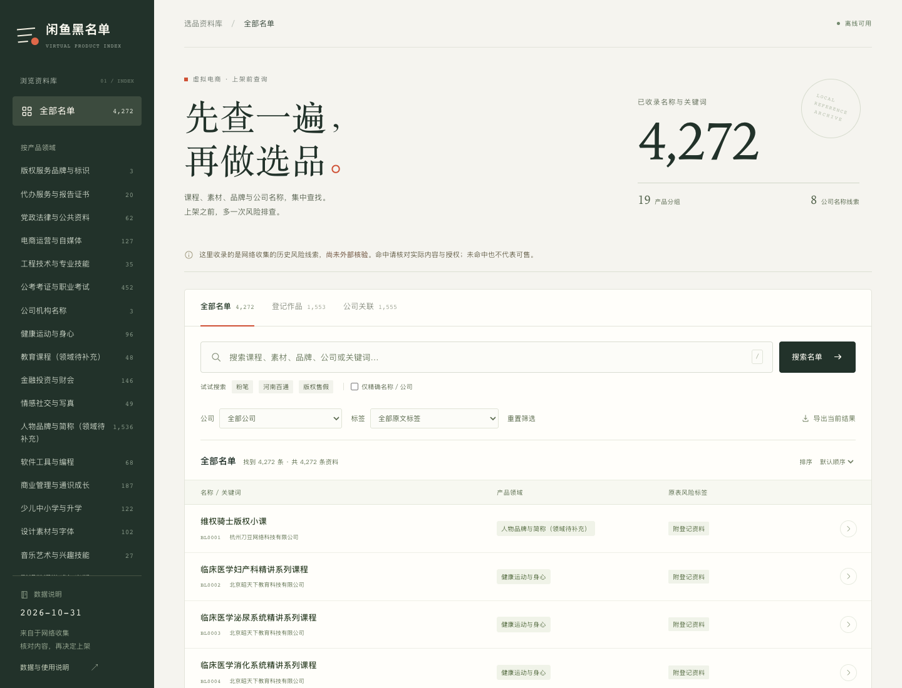
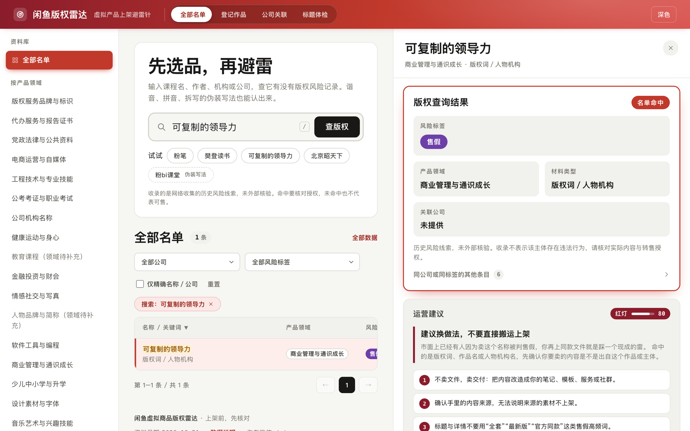
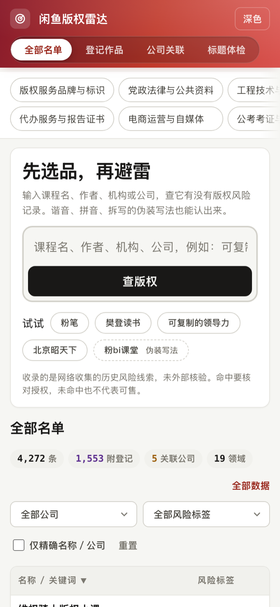

# 闲鱼虚拟商品黑名单查询助手

做闲鱼、小红书、淘宝虚拟选品时，查一查产品、课程、素材、品牌和公司是否命中风险名单。支持网页搜索，也可以作为 Skill 接入你的选品工具。

## 网页使用

**[在线打开查询助手](https://yhslgg-arch.github.io/xianyu-blacklist/)**，点击即可搜索，无需下载。

[下载本项目](https://github.com/yhslgg-arch/xianyu-blacklist/archive/refs/heads/main.zip)并解压，双击 **`index.html`** 即可搜索，无需安装。

支持分类筛选、查看详情和导出查询结果，手机也能使用。

## 安装 Skill

需要 Python 3.10 或以上版本。Codex 用户在终端运行：

```bash
git clone https://github.com/yhslgg-arch/xianyu-blacklist.git ~/.codex/skills/virtual-product-risk-checker
```

Claude Code 用户将安装路径改为 `~/.claude/skills/virtual-product-risk-checker`。如果目标目录已存在，请先更新已有版本。

重新打开客户端后，直接说：

```text
用 $virtual-product-risk-checker 检查这批虚拟商品，
把命中名称、风险标签和需要核对的授权列出来。
```

也可以让其他选品工具在推荐产品前调用这个 Skill，检查后再输出选品结果。

## 界面预览

**名单浏览与搜索**



**查询详情**



**手机界面**



## 进阶使用

- [接入其他选品工具与批量查询](references/selection-integration.md)
- [导入自己的名单](references/importing.md)

## 数据与许可

数据来自网络收集，仅供选品风险排查参考。查询结果不等于版权或销售授权结论。

程序与说明采用 [MIT 许可](LICENSE)，名单数据的使用边界见[数据说明](DATA_NOTICE.md)。
